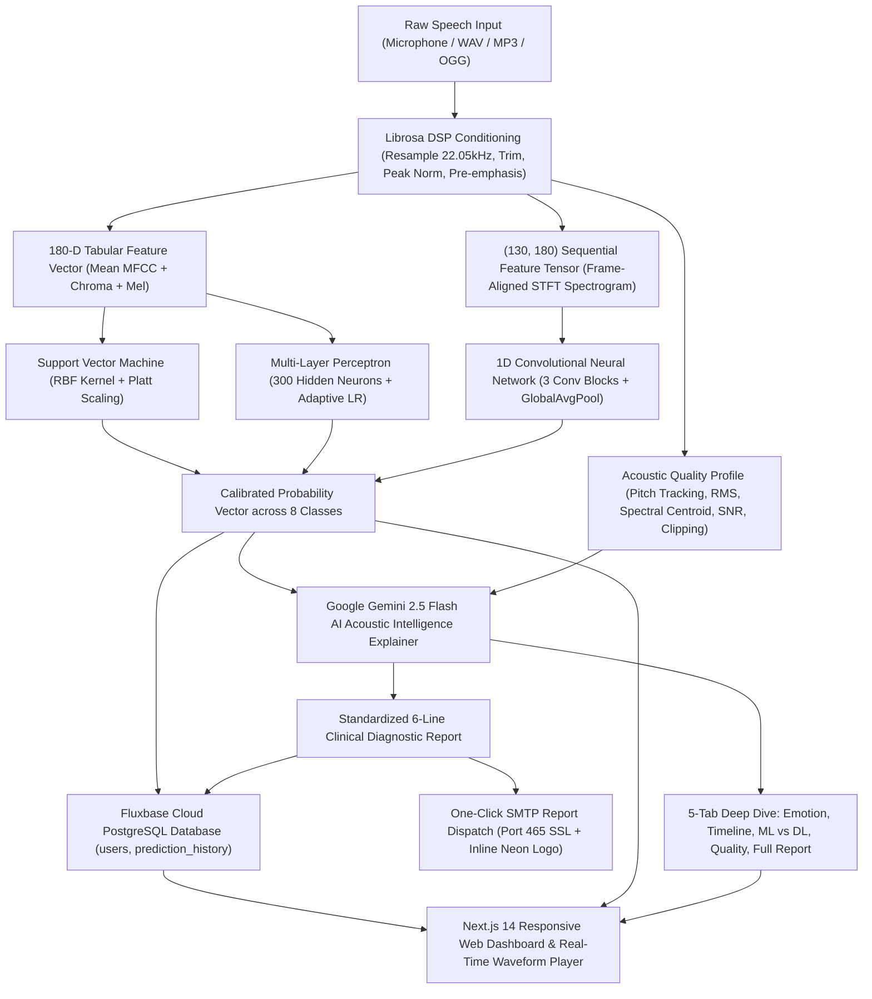
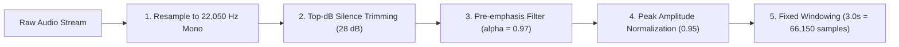
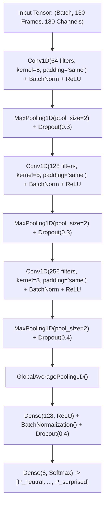

# EmotiSound AI: End-to-End Implementation Guide

> **Acoustic Speech Emotion Recognition (SER) System**  
> Full-Stack Architecture, Digital Signal Processing, Deep Learning (1D CNN), Traditional Machine Learning (SVM, MLP), Google Gemini AI Acoustic Intelligence, Fluxbase Cloud Database, and SMTP Dispatch.

---

## Table of Contents
1. [Executive Summary & High-Level Architecture](#1-executive-summary--high-level-architecture)
2. [Datasets & Data Ingestion](#2-datasets--data-ingestion)
3. [Audio Preprocessing & Signal Conditioning](#3-audio-preprocessing--signal-conditioning)
4. [Acoustic Feature Extraction Pipeline](#4-acoustic-feature-extraction-pipeline)
5. [Machine Learning & Deep Learning Models](#5-machine-learning--deep-learning-models)
   - [5.1 1D Convolutional Neural Network (Deep Learning)](#51-1d-convolutional-neural-network-deep-learning)
   - [5.2 Multi-Layer Perceptron (Neural Network)](#52-multi-layer-perceptron-neural-network)
   - [5.3 Support Vector Machine (Kernel ML)](#53-support-vector-machine-kernel-ml)
6. [Empirical Evaluation & Benchmark Results](#6-empirical-evaluation--benchmark-results)
7. [AI Acoustic Intelligence Explainer (Google Gemini 2.5 Flash)](#7-ai-acoustic-intelligence-explainer-google-gemini-25-flash)
   - [7.1 Core Capabilities & Persona](#71-core-capabilities--persona)
   - [7.2 Automated 6-Line Diagnostic Report](#72-automated-6-line-diagnostic-report)
   - [7.3 Intelligent Local DSP Fallback Engine](#73-intelligent-local-dsp-fallback-engine)
8. [Cloud Infrastructure & Persistent Services](#8-cloud-infrastructure--persistent-services)
   - [8.1 Fluxbase Cloud Database](#81-fluxbase-cloud-database)
   - [8.2 SMTP Notification & Report Delivery Engine](#82-smtp-notification--report-delivery-engine)
   - [8.3 JWT Authentication & Session Security](#83-jwt-authentication--session-security)
9. [Frontend Application Architecture (Next.js 14)](#9-frontend-application-architecture-nextjs-14)
10. [REST API Specification](#10-rest-api-specification)
11. [Installation, Configuration & Reproduction Guide](#11-installation-configuration--reproduction-guide)

---

## 1. Executive Summary & High-Level Architecture

EmotiSound AI classifies human vocal recordings into **8 canonical emotion classes**:
`Neutral`, `Calm`, `Happy`, `Sad`, `Angry`, `Fearful`, `Disgust`, and `Surprised`.

The system bridges low-level psychoacoustic signal processing, sequential neural modeling, and Large Language Model (LLM) reasoning to deliver not just a raw classification score, but actionable diagnostic explanations and automated email reporting.

### End-to-End System Pipeline:



---

## 2. Datasets & Data Ingestion

The models are trained and evaluated on two benchmark speech emotion databases:

| Dataset | Sample Count | Speakers | Emotions Included | Sampling Rate | Official Source |
|---|---|---|---|---|---|
| **RAVDESS** | 1,440 clips | 24 professional actors (12M / 12F) | 8 classes (Neutral, Calm, Happy, Sad, Angry, Fearful, Disgust, Surprised) | 48 kHz 16-bit WAV | [Zenodo (CERN)](https://zenodo.org/records/1188976/files/Audio_Speech_Actors_01-24.zip) |
| **TESS** | 2,800 clips | 2 actresses (Younger & Older adult) | 7 classes (Mapped to unified 8-class taxonomy) | 24.4 kHz 16-bit WAV | [Hugging Face](https://huggingface.co/datasets/myleslinder/tess/resolve/main/data/tess.zip) |
| **Total** | **4,240 clips** | **26 unique speakers** | **8 unified target emotions** | Standardized to **22,050 Hz** | Combined Corpus |

### Speaker-Independent Partitioning:
To prevent **vocal timbre data leakage** (where a model memorizes a speaker's unique voice pitch rather than emotion features), data splitting is strictly **speaker-independent**:
- **Testing Set**: Exactly **800 clips** from dedicated actors whose voices never appear during training or validation.
- **Training & Validation Set**: **3,440 clips** with 5-fold cross-validation.

---

## 3. Audio Preprocessing & Signal Conditioning

All incoming audio signals undergo a 5-stage conditioning pipeline in `backend/training/preprocessing.py` and `backend/services/audio_service.py`:



1. **Resampling**: Standardized to `22,050 Hz` single-channel mono. Captures up to the Nyquist frequency of `11,025 Hz`, containing all essential vocal formants (F1, F2, F3).
2. **Silence Trimming**: Removes non-vocal start/end pauses using `librosa.effects.trim(y, top_db=28)`.
3. **Pre-emphasis Filtering**: Boosts high-frequency components that naturally attenuate in human speech:
   $$y_{\text{filtered}}[n] = y[n] - 0.97 \cdot y[n-1]$$
4. **Peak Amplitude Normalization**: Prevents clipping distortion and levels microphone gain:
   $$y_{\text{norm}} = 0.95 \cdot \frac{y}{\max(|y|) + 10^{-7}}$$
5. **Fixed Duration Enforcement**: Uniformly pad (with reflection) or center-crop to exactly **3.0 seconds** ($3 \times 22,050 = 66,150$ samples).

---

## 4. Acoustic Feature Extraction Pipeline

Audio is transformed into two distinct representations to serve both traditional ML and sequential Deep Learning:

### 4.1 Tabular Acoustic Vector (180 Features for SVM & MLP)
Extracted by computing statistical temporal averages across the whole clip:
- **40 MFCCs (Mel-Frequency Cepstral Coefficients)**: Captures vocal tract shape and spectral envelope.
- **12 Chroma STFT**: Quantifies energy distribution across the 12 semitone musical pitch classes (harmonic profile).
- **128 Mel-Scale Spectrogram Bands**: Captures perceived frequency response according to human auditory filters.
- **Output Vector**: $40 + 12 + 128 = \mathbf{180}$ continuous values per recording, scaled using `StandardScaler`.

### 4.2 Sequential Acoustic Matrix (130 × 180 Tensor for 1D CNN)
Preserves time-dependent inflections:
- Extracted with Short-Time Fourier Transform (STFT) window `n_fft = 2048`, `hop_length = 512`.
- At 22,050 Hz, a 3.0s recording yields exactly **130 chronological frames**.
- Each frame contains the concatenated 180 channels (40 MFCCs + 12 Chroma + 128 Mel).
- **Output Tensor Shape**: `(batch_size, 130, 180)`.

### 4.3 Signal Quality & Diagnostic Profiling (`acoustic_analyzer.py`)
In parallel with inference, the backend evaluates the physical recording quality:
- **Fundamental Frequency ($F_0$ Pitch)**: Probabilistic YIN algorithm (`librosa.pyin`) calculating mean, standard deviation, and range in Hz.
- **Root Mean Square (RMS) Energy**: Average acoustic power in dBFS.
- **Spectral Centroid**: Center of mass of the spectrum measuring timbral brightness.
- **Signal-to-Noise Ratio (SNR)**: Decibel ratio comparing voiced speech energy to ambient silent background noise.
- **Clipping Detection**: Percentage of samples hitting digital maximum ($\ge 0.99$).

---

## 5. Machine Learning & Deep Learning Models

### 5.1 1D Convolutional Neural Network (Deep Learning)
Defined in `backend/training/train_cnn.py` and saved as `backend/models/cnn_model.keras`:



- **Loss Function**: Categorical Cross-Entropy
- **Optimizer**: Adam with learning rate reduction on plateau (`ReduceLROnPlateau`, factor=0.5, patience=5, min_lr=1e-5)
- **Regularization**: Batch Normalization, Dropout (30%–40%), and Early Stopping (patience=15).

### 5.2 Multi-Layer Perceptron (Neural Network)
Defined in `backend/training/train_mlp.py` and serialized to `backend/models/mlp_model.pkl`:
- **Architecture**: `MLPClassifier(hidden_layer_sizes=(300, 150), activation='relu', solver='adam')`
- **Learning Rate**: Adaptive (`learning_rate='adaptive'`, initial $\eta = 0.001$)
- **Max Iterations**: 500 epochs with early stopping on validation loss.

### 5.3 Support Vector Machine (Kernel ML)
Defined in `backend/training/train_svm.py` and serialized to `backend/models/svm_model.pkl`:
- **Algorithm**: `SVC(C=10.0, kernel='rbf', gamma='scale', probability=True)`
- **Probability Calibration**: Platt scaling enabled (`probability=True`) to convert hyperplane margins into calibrated posterior probabilities.

---

## 6. Empirical Evaluation & Benchmark Results

The models were evaluated on the **800 held-out speaker-independent test clips**:

| Model | Model File | Test Accuracy | Weighted Precision | Weighted Recall | Weighted F1-Score | Inference Latency |
|---|---|---|---|---|---|---|
| **1D CNN** | `cnn_model.keras` (3.9 MB) | **82.63%** | **84.34%** | **82.62%** | **82.30%** | ~18 ms |
| **MLP** | `mlp_model.pkl` (697 KB) | **79.75%** | **81.15%** | **79.75%** | **79.77%** | ~2 ms |
| **SVM** | `svm_model.pkl` (2.6 MB) | **79.12%** | **81.54%** | **79.12%** | **79.68%** | ~4 ms |

### Why 1D CNN Outperforms Tabular ML:
Traditional SVM and MLP average features over the entire 3-second window, losing chronological order. In contrast, 1D CNN preserves the 130 sequential time frames, detecting prosodic shifts such as sudden pitch spikes in *Angry* or gradual downward inflections in *Sad*.

---

## 7. AI Acoustic Intelligence Explainer (Google Gemini 2.5 Flash)

Integrated in `backend/services/ai_explainer_service.py` to provide deep contextual audio intelligence.

### 7.1 Core Capabilities & Persona

The model is initialized with the system instruction:
> *"You are the EmotiSound AI Acoustic Intelligence Assistant, an expert in Digital Signal Processing (DSP), Speech Emotion Recognition (SER), psychoacoustics, and Machine Learning..."*

It powers 4 diagnostic modules:
1. **Emotion Explainer**: Explains why the audio was classified as the primary emotion, connecting pitch (F0), RMS power, and spectral brightness.
2. **Voice & Timeline Analyst**: Traces emotional shifts chronologically across audio segments (onset, body, cadence) and audits physical recording quality (SNR, clipping, noise).
3. **ML vs DL Model Comparison**: Explains architectural divergences between SVM hyperplane boundaries, MLP non-linear activations, and 1D CNN sequential convolutions.
4. **Personalized Analysis Report**: Synthesizes a structured clinical/technical executive report.

### 7.2 Automated 6-Line Diagnostic Report

Every prediction automatically produces a standardized 6-sentence summary formatted for immediate email dispatch and dashboard display:
- **Line 1 (Classification)**: Primary emotion label, confidence percentage, and active model.
- **Line 2 (Acoustic Mechanics)**: Pitch ($F_0$), RMS energy (dBFS), and spectral brightness (Hz).
- **Line 3 (Temporal Dynamics)**: Chronological progression across recording segments.
- **Line 4 (Model Comparison)**: Contrast between CNN, MLP, and SVM predictions.
- **Line 5 (Audio Quality)**: SNR rating in dB, clipping percentage, and background noise assessment.
- **Line 6 (Clinical Summary)**: Final holistic diagnostic takeaway.

### 7.3 Intelligent Local DSP Fallback Engine
If the `GEMINI_API_KEY` is not configured or the network is unavailable, the backend automatically falls back to an internal **Intelligent DSP Rule Engine**. The application remains 100% operational, computing deterministic acoustic explanations based on librosa feature thresholds.

---

## 8. Cloud Infrastructure & Persistent Services

### 8.1 Fluxbase Cloud Database
The application integrates with **Fluxbase Cloud PostgreSQL** (`https://fluxbase.vercel.app/api/execute-sql`) via `backend/services/fluxbase_client.py`.

#### Managed Tables:
```sql
-- 1. Users Table
CREATE TABLE IF NOT EXISTS users (
    id SERIAL PRIMARY KEY,
    username VARCHAR(100) UNIQUE NOT NULL,
    email VARCHAR(255) UNIQUE NOT NULL,
    password_hash VARCHAR(255) NOT NULL,
    created_at TIMESTAMP DEFAULT CURRENT_TIMESTAMP,
    last_login TIMESTAMP
);

-- 2. Prediction History Table
CREATE TABLE IF NOT EXISTS prediction_history (
    id SERIAL PRIMARY KEY,
    user_email VARCHAR(255),
    filename VARCHAR(255),
    predicted_emotion VARCHAR(50),
    confidence FLOAT,
    model_used VARCHAR(50),
    probabilities JSONB,
    acoustic_profile JSONB,
    created_at TIMESTAMP DEFAULT CURRENT_TIMESTAMP
);
```

### 8.2 SMTP Notification & Report Delivery Engine
Implemented in `backend/services/email_service.py`:
- **Protocol**: Direct SSL via port 465 (with automated TLS port 587 fallback).
- **Branding**: Automatically embeds the optimized project logo (`images/logo_email.png`) via MIME multipart `Content-ID: <project_logo>`.
- **Triggers**:
  1. **User Registration**: Dispatches a Welcome Email detailing account activation.
  2. **Security Alert**: Dispatches a Login Alert with client timestamp, IP address, and browser metadata.
  3. **Prediction Report Dispatch**: Sends the 6-Line Diagnostic Report directly to the user's inbox upon clicking **"Send Report"** on `/predict`.

### 8.3 JWT Authentication & Session Security
- Passwords hashed using `bcrypt` (12 salt rounds).
- Stateless JSON Web Tokens (`HS256`) with configurable expiration (`JWT_EXPIRATION_HOURS=168`).
- Dual client storage: HTTP-only cookies and React Auth Context in `frontend/lib/auth-context.tsx`.

---

## 9. Frontend Application Architecture (Next.js 14)

Built using **Next.js 14 App Router**, **TypeScript**, and **Tailwind CSS**:

```text
frontend/
├── app/
│   ├── page.tsx               # Redirects to /dashboard or /login
│   ├── layout.tsx             # Root Layout with AuthProvider, Navbar, and Sidebar
│   ├── login/page.tsx         # User login form with feedback animations
│   ├── register/page.tsx      # User registration with email validation
│   ├── dashboard/page.tsx     # Overview KPI cards, recent activity, and system status
│   ├── predict/page.tsx       # Live audio upload/record, waveform, and AI explanation
│   ├── analytics/page.tsx     # Cross-model evaluation curves and confusion matrices
│   └── history/page.tsx       # Filterable table of past emotion predictions
├── components/
│   ├── AudioRecorder.tsx      # In-browser MediaRecorder with audio visualization
│   ├── AudioUploader.tsx      # Drag-and-drop audio file uploader
│   ├── Waveform.tsx           # Canvas/SVG waveform renderer for audio files
│   ├── EmotionCard.tsx        # Dynamic emotion badge with emoji and confidence bar
│   ├── ConfidenceChart.tsx    # Recharts probability distribution bar graph
│   ├── ModelComparison.tsx    # Side-by-side comparison cards (CNN vs MLP vs SVM)
│   ├── AiPredictionExplanation.tsx # 5-tab AI Explainer + 6-Line Report + Email Dispatch
│   ├── Navbar.tsx             # System health indicators (Fluxbase, SMTP, FastAPI)
│   └── Sidebar.tsx            # Navigation links and authenticated user profile
└── lib/
    ├── api.ts                 # Typed fetch client for all backend REST endpoints
    └── auth-context.tsx       # Authentication state, login, register, and token management
```

---

## 10. REST API Specification

| Method | Endpoint | Request Body | Description |
|---|---|---|---|
| `GET` | `/health` | None | Returns backend status, model readiness, and database health |
| `POST` | `/auth/register` | `{"username", "email", "password"}` | Creates user and dispatches welcome email |
| `POST` | `/auth/login` | `{"email", "password"}` | Authenticates user and issues JWT token |
| `GET` | `/auth/me` | Bearer Token | Returns logged-in user profile |
| `POST` | `/predict` | `multipart/form-data (file, model)` | Evaluates audio file with selected model; returns emotion, waveform, quality profile, and 6-line report |
| `POST` | `/predict-all` | `multipart/form-data (file)` | Evaluates audio simultaneously across SVM, MLP, and 1D CNN |
| `POST` | `/recording` | `multipart/form-data (audio_data)` | Dedicated handler for live in-browser microphone input |
| `POST` | `/predict/send-report` | `{"recipient_email", "report_data"}` | Emails the 6-Line Diagnostic Report via SMTP with embedded logo |
| `GET` | `/history` | Query params: `limit`, `offset` | Retrieves paginated prediction history from Fluxbase |
| `DELETE` | `/history/{id}` | None | Removes a prediction entry from the database |
| `GET` | `/analytics` | None | Delivers full confusion matrices and model benchmark metrics |

---

## 11. Installation, Configuration & Reproduction Guide

### Prerequisites
- **Python 3.10+** (Python 3.12 recommended)
- **Node.js 18+** & **npm**
- **FFmpeg** (installed and added to system PATH for audio decoding)

### Step 1: Clone the Repository
```bash
git clone https://github.com/shree-hari-23/ai-based-speech-classifier.git
cd ai-based-speech-classifier
```

### Step 2: Configure Environment Variables
Copy the template files:
```bash
cp .env.example .env
cp backend/.env.example backend/.env
cp frontend/.env.local.example frontend/.env.local
```

Edit `backend/.env` with your credentials:
```env
# Fluxbase Cloud Database
FLUXBASE_URL=https://fluxbase.vercel.app/api/execute-sql
FLUXBASE_PROJECT_ID=your_fluxbase_project_id
FLUXBASE_API_KEY=your_fluxbase_api_key

# SMTP Email Configuration
SMTP_HOST=smtp.gmail.com
SMTP_PORT=465
SMTP_USER=your_email@gmail.com
SMTP_PASSWORD=your_gmail_app_password
SMTP_FROM_EMAIL=your_email@gmail.com
SMTP_FROM_NAME=EmotiSound AI
SMTP_USE_SSL=True

# Google Gemini API
GEMINI_API_KEY=your_google_gemini_api_key
```

### Step 3: Run the Backend
```bash
cd backend
python -m venv .venv
# Windows:
.venv\Scripts\activate
# Linux/macOS:
# source .venv/bin/activate

pip install -r requirements.txt
python main.py
```
*Backend runs at `http://localhost:8000` (Swagger UI at `http://localhost:8000/docs`).*

### Step 4: Run the Frontend
In a new terminal:
```bash
cd frontend
npm install
npm run dev
```
*Frontend runs at `http://localhost:3000`.*

### Step 5: (Optional) Retrain Models from Scratch
To re-download datasets and retrain all models:
```bash
cd backend
python training/download_datasets.py
python training/train_svm.py
python training/train_mlp.py
python training/train_cnn.py
python training/evaluate_models.py
```
*(Pre-trained model binaries are included in `backend/models/` for immediate out-of-the-box inference).*

---

### End of Documentation
*Document generated for **EmotiSound AI** (Acoustic Speech Emotion Recognition System).*
